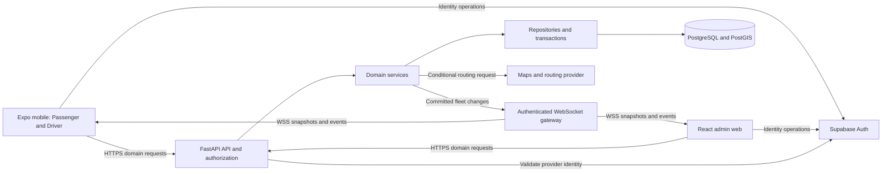
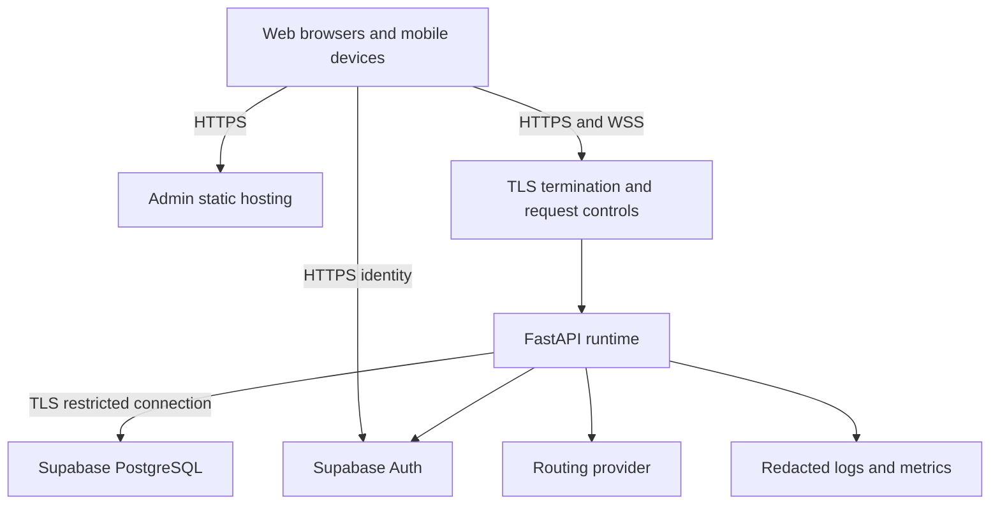

> Current implementation: see [the MVC guide](../../MVC.md). This document records the broader system design; native mobile and deployment scaffolds are not implemented.

# TrackSafar — System Architecture

Version: 1.0 · Date: 2026-10-13 · Status: planned architecture; no component is claimed operational.

Related documents: [SRS](SRS.md) · [Technology stack](teckstack.md) · [Detailed design](design.md) · [Rules](rules.md) · [Tasks](tasks.md)

## 1. Architectural approach

Build a modular monolith: one FastAPI application with clear internal boundaries, backed by PostgreSQL/PostGIS, serving two frontend applications. This keeps integration manageable for three developers rotating between layers. Split services only when measured requirements justify the operational cost.

Supabase Auth owns identity and credentials. FastAPI owns application authorization and domain operations. PostgreSQL is authoritative for assignments and trip state. Driver smartphones supply observations; the backend validates them before exposing sanitized tracking. The maps/routing provider supports presentation and ETA calculations but is not authoritative for bus assignments or trip activity.



The diagram describes intended responsibilities, not implemented connections. Client map rendering also uses the chosen provider's public SDK as applicable; secret routing requests stay on the server.

## 2. Boundaries and folder responsibilities

Paths below are relative to the approved TrackSafar project root. They identify future implementation homes, not files created by this documentation package.

| Folder | Responsibility |
|---|---|
| `frontend/admin-web/src/features` | Users/drivers, buses, routes/stops, assignments, fleet and alert screens. |
| `frontend/admin-web/src/auth`, `services`, `maps` | Web session integration, API/WebSocket transports and map adapters. |
| `frontend/mobile/src/features/passenger` | Discovery, search, route/stop views, tracking, ETA, profile and notifications. |
| `frontend/mobile/src/features/driver` | Assignment, trip actions, sharing status and driver alerts. |
| `frontend/mobile/src/navigation`, `auth`, `components` | Role navigation, common session handling and reusable UI. |
| `frontend/mobile/src/services/location`, `tasks/background-location` | Permission/capture adapters and native background task entrypoints. |
| `backend/app/api/v1/routes` | HTTP transport, request parsing and response/error contracts. |
| `backend/app/auth` | Central identity verification, trusted principal and permission dependencies. |
| `backend/app/services` | Business invariants, transaction orchestration, ETA decisions and publication rules. |
| `backend/app/schemas` | Explicit request/response validation and public/private field boundaries. |
| `backend/app/repositories`, `models` | Parameterized persistence and database mappings. |
| `backend/app/websocket` | Authentication handshake, authorized subscriptions, bounded delivery and disconnect handling. |
| `backend/app/integrations` | Supabase/provider adapters and map/routing requests. |
| `database/supabase` | Authoritative SQL migrations, seeds, policies/functions and database tests. |
| `tests`, app-specific test folders | Cross-system acceptance plus each layer's own tests. |
| `infra`, `scripts`, `.github/workflows` | Deployment/monitoring definitions, repeatable utilities and CI. |

Documentation fits the existing numbered documentation phases. Keep these six cross-linked documents together in a documentation bundle while reviewing them. If they are later moved into separate phase folders, update all relative links in the same change rather than maintaining conflicting copies.

## 3. Identity, sessions and authorization

Clients integrate with the same Supabase Auth project per environment for signup, login, refresh and logout. The backend never builds a second password database. Public signup yields a passenger application profile only. An authenticated identity without a provisioned active profile has no domain access.

The planned FastAPI identity dependency validates cryptographic signature and allowed algorithm, trusted issuer, audience and expiry against configured provider keys; it must support safe key rotation. It then resolves current profile activity and role. Do not trust a client role selector, arbitrary JWT key URL, decode-only claims or user-editable metadata. Sensitive actions require current session/authorization checks appropriate to provider behavior, not indefinite caching.

Services additionally check ownership and assignment state. Being a driver is not permission to update every trip. Being an administrator is not permission to impersonate a driver GPS stream. Profile edits cannot modify role/activity fields. Privileged provisioning and account lifecycle operations go through an audited administrative service.

Logout clears local credentials and invokes provider session revocation. Already-issued access tokens may remain valid for their lifetime unless an additional session check rejects them; implement and test the selected revocation strategy in M1. Deactivation must be enforced in subsequent protected requests and active socket authorization rechecks.

## 4. Database access and consistency

The proposed runtime access model is **backend-mediated domain data**: clients do not directly read or mutate application tables through the Data API. Start with RLS on application tables and unnecessary public-client grants revoked. Add a dedicated server login with only the application privileges/policies it needs. Keep migration-owner credentials separate from runtime credentials. Do not use a database owner or service-role credential as the normal application connection merely to avoid permission errors.

The backend must authorize every operation and scope repository queries by the verified identity/resource. A direct SQL connection does not automatically inherit the caller's Supabase JWT or populate `auth.uid()`. In the initial model, reviewed policies/grants restrict the backend role and FastAPI enforces user-level permissions. If per-user database policies are introduced later, add explicit transaction-scoped identity propagation and pooled-connection isolation tests before relying on them. Never imply that turning on RLS alone completes authorization.

Repositories accept explicit parameters and use bounded queries. Services control transactions; route handlers do not make ad hoc direct SQL calls. Use one Supabase migration history for schema, indexes and grants. SQLAlchemy mappings must follow it rather than create tables independently at startup.

Trip start locks relevant current assignment/driver/bus/route records, verifies eligibility and creates one active trip in a transaction. Database uniqueness constraints provide a final guard against concurrent starts. Trip end locks and updates the trip, removes or invalidates the current location, and commits before publishing removal. Active queries independently exclude ended trips even if an event is missed.

Assignments and referenced route definitions preserve history. Reject ordinary changes that would invalidate an active trip; do not silently terminate service through an unrelated edit. Recovery operations require an explicit audit trail. Detailed entities and invariants are in [design.md](design.md).

## 5. Location ingestion and realtime distribution

1. Driver signs in and requests the current assignment.
2. Backend validates and starts a trip; mobile receives its authoritative ID.
3. Mobile obtains required permissions and begins capture only for that trip.
4. Mobile sends a bounded GPS sample over HTTPS, including trip ID, observed time, coordinates, accuracy and sequence.
5. Backend rechecks trip ownership/activity and validates coordinates, freshness, accuracy and ordering.
6. Database stores the newest accepted observation and server receipt time; older samples cannot overwrite it.
7. After commit, the server publishes sanitized fleet information to permitted subscriptions.
8. Trip end rejects further ingestion and removes the bus from active fleet results.

```mermaid
sequenceDiagram
  participant D as Driver mobile
  participant API as FastAPI
  participant DB as Database
  participant V as Tracking viewers
  D->>API: Start assigned trip with authenticated identity
  API->>DB: Validate and create trip atomically
  DB-->>API: Committed trip
  API-->>D: Trip ID and state
  loop While trip is active and capture is available
    D->>API: Timestamped GPS sample and sequence
    API->>DB: Validate ownership and store newer observation
    DB-->>API: Accepted observation committed
    API-->>V: Sanitized location event
  end
  D->>API: End own trip
  API->>DB: End trip and invalidate current location
  API-->>V: Trip ended; remove active bus
  API-->>D: Confirm ended state
```

**Proposed WebSocket handshake:** accept a transport connection with no subscription privileges, require a small authentication message within a short configured timeout, validate it through the central auth module, and only then permit subscriptions. Never transmit credentials in query strings. Reject disallowed browser origins; native clients still require identity checks. Limit message size, subscription count and outgoing queue length. Authenticate over WSS outside local development.

Define snapshot, location-updated, trip-ended, stale-state and alert event contracts in M4. Include version/sequence and timestamps for reconciliation; exclude driver personal details and passenger GPS. Reconnect obtains a fresh authoritative snapshot before applying subsequent events. Slow clients may need disconnection and resynchronization rather than unbounded buffering.

A single-process broadcaster is permissible only for a documented one-instance deployment. Multiple workers/instances require shared fan-out and consistent authorization coordination. Durable event/outbox infrastructure is a later change if required; regardless, snapshot recovery must correct missed events and active queries must not show ended trips.

## 6. Discovery and ETA dependencies

Nearby discovery uses accepted active positions and geographic distance filtering. It must distinguish no matching buses from no usable passenger location, backend failure and stale fleet data. Search uses registered catalog identifiers/names.

ETA depends on a fresh observation, a valid route/direction, target stop sequence, trip progress and a reviewed estimation/routing method. Route paths cannot be inferred as genuine from a few invented points. A provider outage must not become a fabricated ETA. Return a nullable estimate with a clear reason/observation context; the UI must retain an unavailable state. The exact ETA algorithm is an M5 contract decision backed by route evidence.

## 7. Deployment and failure boundaries



Use separate environment configuration and credentials. Liveness checks indicate process health; readiness checks verify critical dependencies without presenting a partially configured system as ready. Restrict CORS, configure proxy socket timeouts and avoid logging authorization headers or full GPS histories.

| Failure | Required system response |
|---|---|
| Auth/session invalid | Deny operation; prompt re-authentication without leaking private state. |
| Database unavailable | No successful write acknowledgment; return retryable failure where safe. |
| GPS permission revoked | Stop capture, display permission state and let backend freshness expire. |
| Network interrupted | Show disconnected state; bounded retry; revalidate trip before resuming. |
| App force-stopped | Do not promise background delivery; stale tracking becomes visible. |
| Routing provider unavailable | Tracking may continue; ETA is unavailable. |
| Socket disconnect/missed event | Reconnect with authentication and authoritative snapshot. |
| Trip ended while device offline | Reject queued observations; stop capture after reconciliation. |

## 8. Architecture decisions and change control

The baseline choices are a modular monolith, one identity provider, backend-mediated application data, one public WebSocket feed, and conditional ETA. Changes to these boundaries require a short ADR describing the problem, alternatives, decision and consequences. Store future ADRs in the approved design/ADRs folder and update this document and affected tasks. Detailed risk, version and release decisions remain visible in the SRS decision register.
