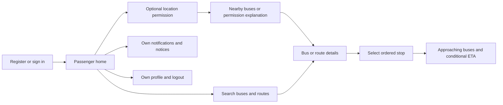
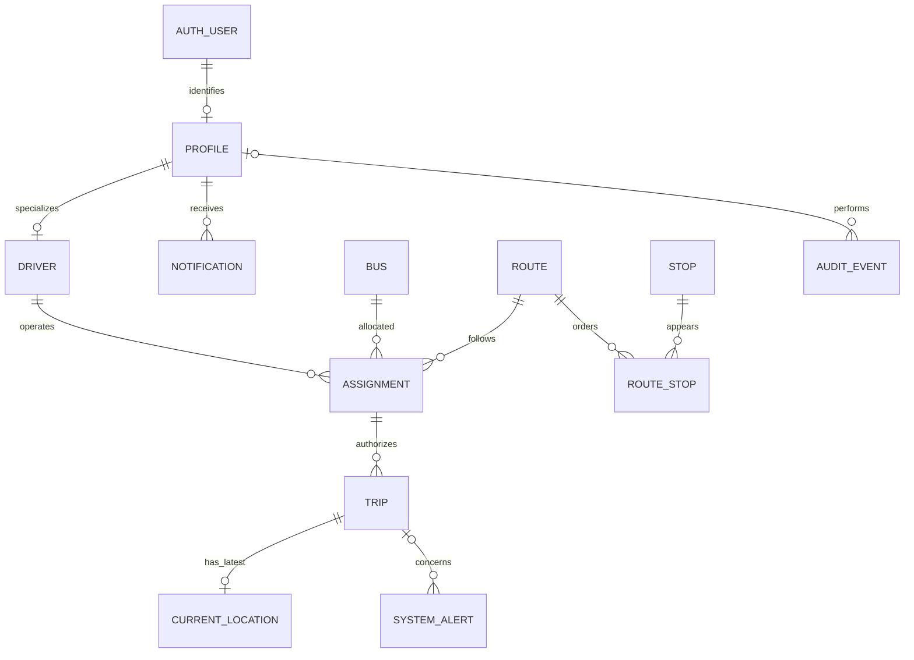
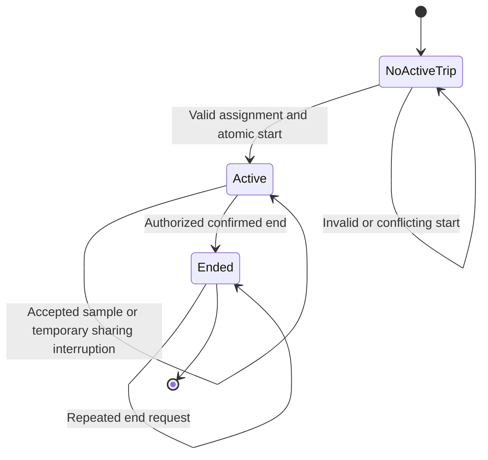

# TrackSafar — UI and Detailed System Design

Version: 1.0 · Date: 2026-10-13 · Status: planned design; diagrams are conceptual, not deployed schema.

Related documents: [SRS](SRS.md) · [Technology stack](teckstack.md) · [Architecture](architecture.md) · [Rules](rules.md) · [Tasks](tasks.md)

## 1. Design purpose and conventions

This document specifies screens, states, conceptual entities and module interactions. It does not replace the system boundaries in architecture or the requirements in SRS. Names below are domain concepts; final columns and payload contracts are reviewed during the relevant milestone before code or migrations are written.

Use **Passenger**, **Driver**, **Administrator**, **Bus**, **Route**, **Stop**, **Assignment**, **Trip**, **Location observation**, **Notification**, and **System alert** consistently. Display labels may say Administrator; the proposed internal role identifier is `admin`. A route is a registered direction-specific service path. A trip is one authorized run against an assignment. A location observation has both device observation time and server receipt time.

## 2. Navigation and screen flows

### Passenger panel

Proposed bottom navigation: **Home**, **Search**, **Alerts**, **Profile**. Route/stop/bus details open from Home or Search. The Home map/list offers nearby discovery only after location consent; manual search remains available.

| Screen | Main content/actions | Required alternative states |
|---|---|---|
| Sign-in/registration | Credentials, verification guidance and passenger-only signup | Invalid credentials, pending verification, provisioning failure, offline |
| Home/discovery | Location request, map/list toggle, nearby results | Permission denied, locating, no nearby buses, service unavailable |
| Search | Bus number/route number/name, results | Empty input, no matches, loading, retryable error |
| Route detail | Origin/destination, direction, path, ordered stops, active buses | Route inactive, missing geometry, no active trips |
| Stop detail | Stop identity, route context, approaching trips | No approaching trips, unknown progress, unavailable estimates |
| Bus/trip tracking | Latest position, observed time, route and selected-stop ETA | Fresh, stale, disconnected, trip ended |
| Alerts/profile | Intended messages, read state, allowed profile fields, logout | No messages, failed save, denied update, session expired |

### Driver panel

Proposed navigation: **My trip**, **Network**, **Alerts**, **Account**. Network provides the common bus/route/stop/tracking views required for all roles. Driver operational controls remain on My trip so browsing does not obscure sharing status.

Flow: sign in → retrieve assignment → inspect bus/route → start validated trip → permission/capture checks → active trip screen → request trip end → authoritative ended confirmation.

| Screen/state | Required behavior |
|---|---|
| Assignment | Show assigned bus and route; display explicit no-assignment/inactive/conflict states; start action depends on backend eligibility. |
| Active trip | Show bus/route, trip state, permission state, connectivity and last server-accepted sample time. |
| Sharing interrupted | Explain GPS/network/permission reason and actionable recovery; do not imply the trip ended merely because capture stopped. |
| End trip | Confirm intent; disable duplicate taps while pending; after success stop local tasks and clear active-trip UI. |
| Offline end request | Stop local capture if requested, visibly mark server end unconfirmed, retry idempotently and reconcile; never claim confirmed trip completion before acknowledgment. |

Background capture is a platform-constrained feature. Permission screens explain why location is needed during a trip and how to stop it. Do not promise operation after force termination.

### Administrator dashboard

Proposed sidebar: **Fleet**, **Users & drivers**, **Buses**, **Routes**, **Stops**, **Assignments**, **Alerts**. All management screens require server-enforced administrator access.

Each catalog page provides searchable/paginated records, detail view, explicit create/edit actions, activation state and a confirmation for destructive or service-affecting actions. Assignment editing validates availability before submission and still handles server conflicts. Route-stop editing displays sequence visibly and supports a repeated stop at a different sequence for loop routes.

Fleet combines an active-trips list, map, last-observation ages and operational alerts. An ended trip disappears from the active view; a stale observation becomes visibly stale rather than moving by simulation. Private account details belong in authorized management screens, not general tracking responses.

## 3. Shared interface states and accessibility

| State | Presentation rule |
|---|---|
| Loading | Show a loading label/progress indicator; do not display arbitrary live counts. |
| Empty | State exactly what is empty, such as no matching routes or no nearby fresh buses. |
| Error | Explain the failed action and safe retry; preserve valid user input. |
| Offline/disconnected | Keep permitted cached context with its age and a disconnected label. |
| Stale | Display last observation time/age and stale label; suppress ETA derived from stale inputs. |
| Forbidden | Explain access is unavailable without disclosing another user's private records. |
| Ended trip | Remove from active tracking and state that the trip has ended. |
| Unavailable ETA | Show an unavailable label/reason, not zero minutes or an unverified estimate. |

Use shared buttons, labeled inputs, confirmation dialogs, status badges, list rows and map legends. Status must not depend on color alone. Provide keyboard focus and logical tab order on web, accessible names and screen-reader summaries, scalable text and sufficient contrast. Provide a list-based alternative to map-only information. Use device-local display time with clear labels while exchanging UTC timestamps internally. English labels are the starting default; additional languages require review and translation work.

Any synthetic demonstration dataset must have a visible demo label and remain isolated from live environments. Do not animate movement beyond observed positions in a way that implies fresh GPS evidence.

## 4. Conceptual entity relationship model

The identity/profile relationship allows a temporarily unprovisioned identity, which has no domain access. Passengers and administrators are profile roles; separate password-bearing tables for these roles are not needed.

| Entity | Key information | Constraints/responsibility |
|---|---|---|
| Auth user | Provider identity ID and provider-managed credential/session information | Owned by Supabase Auth; never manually seed application passwords. |
| Profile | Identity ID, display name, trusted role, active state | One per provisioned user; role/activity excluded from self-service edits. |
| Driver | Profile reference, operational identifier, active state | Must correspond to a trusted driver profile; required for assignment. |
| Bus | ID, bus number, registration identifier, operator, active state | Unique identifiers; no conflicting current assignment or active trip. |
| Route | ID/number/name, origin, destination, direction, path, active state | Direction-specific default; geometry is sourced and reviewed. |
| Stop | ID, name, validated coordinates, geographic point, active state | Geographic bounds and suitable index; no fabricated coordinates. |
| Route stop | Route, stop, positive sequence | Unique sequence within route; a stop may recur at another sequence. |
| Assignment | Driver, bus, route, start/end validity | At most one current assignment per driver/bus under the initial model; preserve history. |
| Trip | Assignment reference, preserved driver/bus/route identity, start/end time | At most one active trip per bus/driver; end is safe to retry. |
| Current location | Trip, coordinates, accuracy, sequence, observed/received times | At most one newest accepted observation per trip; absent before first accepted sample. |
| Notification | Recipient, content, created/read time | Recipient-only access except authorized administration; no cross-user marking read. |
| System alert | Kind, severity, audience, optional trip, content, lifecycle times | Separate passenger-safe notices from operational incidents. |
| Audit event | Actor where available, action, entity reference, time | Restricted append-oriented operational evidence; no tokens or unnecessary sensitive payloads. |

Raw location history is not required for the first release. Add it only with an approved purpose, retention policy and access controls. Historical route references must remain meaningful: block unsafe edits during active trips and decide whether later route revisions need version records during schema design.

## 5. Lifecycle and invariants

Trip state and sharing state are separate. A trip can remain active while permission/network/GPS prevents sharing. Proposed sharing states are inactive, requesting-permission, locating, sending, confirmed, interrupted and stopping. Only a recent accepted server observation supports the live label; freshness thresholds come from M4 evidence.

Core invariants:

1. A public registrant cannot choose driver/admin role.
2. A driver can act only on their own eligible assignment/trip.
3. Bus and driver each have at most one active trip.
4. A trip cannot outlive an ordinary reassignment underneath it; conflicting management edits are blocked.
5. GPS coordinates are finite and bounded; timestamps, accuracy and ordering are checked.
6. Older or duplicated updates cannot move the current position backward in observation order.
7. Ended trips reject GPS ingestion and are excluded from active queries.
8. Route/stop direction and progress must be known before claiming a bus is approaching a selected stop.
9. Referenced history is not silently destroyed by account/catalog deletion.

## 6. Module interaction and contract responsibilities

| Interaction | Input responsibility | Service/repository responsibility | Output and error responsibility |
|---|---|---|---|
| Signup/profile provisioning | Identity provider session; no accepted elevated role field | Create/recover passenger profile; keep provisioning idempotent | Active profile or explicit pending/failure state |
| Catalog CRUD | Typed admin input and validated identifiers | Authorize admin; protect references/active trips; audit changes | Saved record or validation/conflict/forbidden error |
| Assignment/trip start | Authenticated driver and intended current assignment | Lock, verify all eligibility and enforce uniqueness | Authoritative trip or conflict; no partial success |
| GPS ingestion | Trip ID, coordinates, observation time, accuracy, monotonic ordering | Derive driver/bus; validate and store only newest acceptable sample | Accepted/rejected result without leaking other trips |
| Fleet subscription | Authenticated viewer and bounded route/fleet selection | Authorize feed; snapshot/reconcile; sanitize events | Versioned snapshot/events or explicit disconnect reason |
| Discovery/stop/ETA | Valid location or catalog/trip/stop selection | Filter active/fresh candidates and evaluate route progress/method | Matches/estimate or explained empty/unavailable state |
| Notifications | Current identity and intended own message action | Enforce recipient/audience; persist read/lifecycle status | Own message state only |

The contract workshop for each milestone records fields, allowed operations, errors, pagination and representative success/failure examples. This document intentionally contains no application source code or SQL migration. Those contracts must be agreed by all three layer owners before parallel implementation.

## 7. Design verification

Review each role's flow against its SRS IDs and the integration gate in [tasks.md](tasks.md). Test empty/error/offline/forbidden states as well as successful screens. Verify the ERD supports every proposed relation without creating unnecessary entities for credentials or artificial data. Any change to permissions, trip state, location freshness or alert audiences must update the SRS, architecture and tests together.
