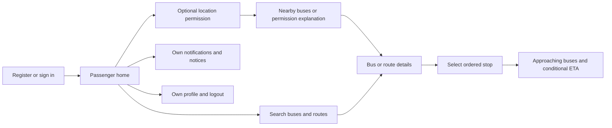
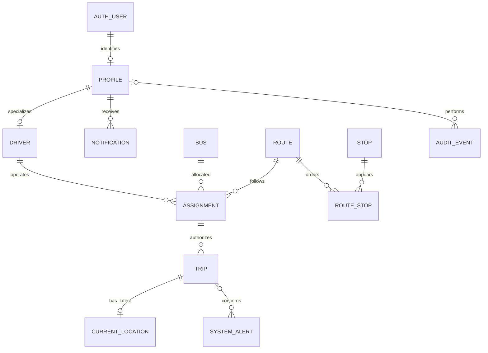
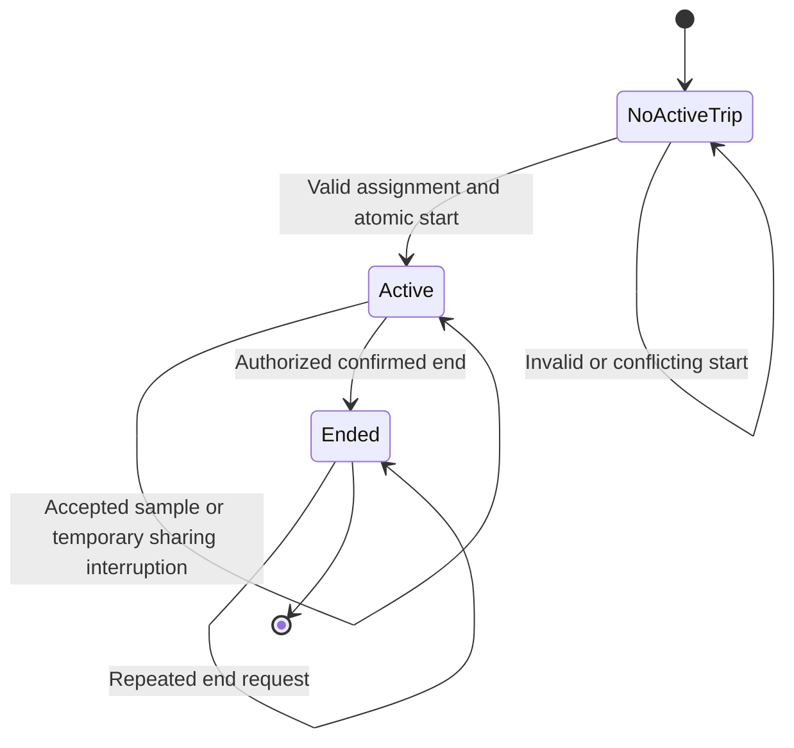

# TrackSafar — UI and Detailed System Design

Version: 1.1 · Updated: 2026-10-22 · Status: shared colour standard for implementation; screen flows and system diagrams remain planned/conceptual, not deployed schema.

Related documents: [SRS](../../../01-requirements/SRS/SRS.md) · [Technology stack](../../../teckstack.md) · [Architecture](../../architecture/architecture.md) · [Rules](../../../rules.md) · [Tasks](../../../tasks.md)

## 1. Design purpose and conventions

This document specifies screens, states, conceptual entities and module interactions. It does not replace the system boundaries in architecture or the requirements in SRS. Names below are domain concepts; final columns and payload contracts are reviewed during the relevant milestone before code or migrations are written.

Use **Passenger**, **Driver**, **Administrator**, **Bus**, **Route**, **Stop**, **Assignment**, **Trip**, **Location observation**, **Notification**, and **System alert** consistently. Display labels may say Administrator; the proposed internal role identifier is `admin`. A route is a registered direction-specific service path. A trip is one authorized run against an assignment. A location observation has both device observation time and server receipt time.

### 1.1 One colour scheme for all three members

**All contributors must use the same TrackSafar palette for Passenger, Driver, Administrator and public authentication screens.** A member's assigned panel or milestone does not introduce a separate theme. The shared visual direction is deep teal, mint accents, white cards and light neutral backgrounds.

The tables below specify the exact values already defined in the web application's [shared theme](../../../../frontend/admin-web/src/styles/index.css). This document defines their meaning and usage; that stylesheet is the web implementation source. Keep both in sync when a palette change is reviewed.

The current standard is a light theme. Dark mode and additional brand colours require a coordinated theme update covering every panel. A screenshot or mockup is a layout reference, not a reason to sample a slightly different green or grey.

### 1.2 Required palette

Token names below map to CSS variables by adding `--color-`. For example, `brand-700` is `--color-brand-700`.

#### Brand colours

| Token | Exact HEX | Intended use |
|---|---|---|
| `brand-50` | `#E6F7F2` | Very light brand backgrounds and account-icon backgrounds |
| `brand-100` | `#D1F2E8` | Selected navigation backgrounds, soft brand badges and focus halos |
| `brand-200` | `#A6E5D3` | Decorative brand borders and separators |
| `brand-300` | `#6FD4BB` | Decorative progress tracks and illustrations |
| `brand-400` | `#2EC49F` | Decorative highlights; not default body text |
| `brand-500` | `#00B386` | Mint accent and brand illustration details |
| `brand-600` | `#009872` | Focus outlines and non-text accent details |
| `brand-700` | `#006852` | **Primary action background**, links, brand icons and selected filter chips |
| `brand-800` | `#00543F` | Primary action hover state |
| `brand-900` | `#003D2E` | Primary action pressed state |

Use white text on `brand-700`, `brand-800` and `brand-900`. Use `ink` text on light mint fills, including `brand-500`; white normal-size text on `brand-500` does not meet the text-contrast target. Mint is an accent, not a second primary button colour.

#### Backgrounds, borders and text

| Token | Exact HEX | Intended use |
|---|---|---|
| `surface` | `#FFFFFF` | Cards, headers, dialogs, input backgrounds and text on dark primary buttons |
| `surface-muted` | `#F8FAF9` | Page canvas, neutral sections, secondary-button hover and empty map area |
| `border` | `#E4E9E7` | Decorative card edges, dividers and table separators |
| `border-strong` | `#CDD5D2` | Default input and secondary-button borders; do not rely on this subtle border alone to identify a control |
| `ink` | `#14201C` | Headings, body text, input values and primary labels |
| `ink-muted` | `#5B6B66` | Descriptions, supporting labels, timestamps and readable placeholders |
| `ink-faint` | `#8B9894` | Decorative details and inactive controls; not essential instructions or readable placeholder text |

#### Status colours

Use the foreground/background pair together, with a visible status label and an appropriate icon.

| Meaning | Foreground token / HEX | Background token / HEX | Example |
|---|---|---|---|
| Success | `success` / `#067647` | `success-soft` / `#ECFDF3` | Profile saved; sharing confirmed by the server |
| Warning | `warning` / `#B54708` | `warning-soft` / `#FFFAEB` | Stale position; permission or connection needs attention |
| Error / danger | `danger` / `#B42318` | `danger-soft` / `#FEF3F2` | Failed save, destructive confirmation, sign-out action |
| Information | `info` / `#175CD3` | `info-soft` / `#EFF8FF` | Informational guidance and a real passenger-location indicator |

Brand teal means an action or selection; it is not evidence that a trip is live. Use the appropriate status token and text for operational meaning.

### 1.3 Component colour rules

| Component or state | Required treatment |
|---|---|
| Primary button: Sign in, Save, Start trip | `brand-700` background + `surface` text; hover `brand-800`; pressed `brand-900` |
| Secondary button: Cancel, Edit profile, Retry | `surface` background + `ink` text + `border-strong` border; hover `surface-muted` |
| Sign out / destructive action | `danger-soft` background + `danger` text; use a solid `danger` button with `surface` text for the destructive confirmation |
| Active navigation item | `brand-100` background + `brand-700` label/icon, with a visible selection indicator |
| Inactive navigation item | `ink-muted` label/icon on `surface`; hover `surface-muted` |
| Selected All / Speedo / Electric chip | `brand-700` background + `surface` text/icon; selection also exposed through the control's accessible state |
| Unselected service chip | `surface-muted` background + `ink-muted` text/icon; service name/icon identifies the service |
| Header account button | `brand-50` circular background + `brand-700` person icon |
| Profile initials avatar | Solid `brand-700` background + `surface` initials; no separate panel-specific avatar gradient |
| Card, profile row, table, bottom sheet | `surface` background, `ink` main text, `ink-muted` secondary text and `border` separators |
| Input | `surface` background, `ink` value, `ink-muted` placeholder and a permanent visible label |
| Focused input / keyboard focus | `brand-600` outline; use `brand-100` only as a supplementary halo, never the sole focus indicator |
| Invalid input | `danger` border and error text, plus an explicit error message associated with the input |
| Disabled control | `surface-muted` fill, `ink-muted` or `ink-faint` content and an actual disabled state; explain why when useful |
| Loader and skeleton | Brand loader uses `brand-700`/`brand-500`; skeletons use `border` and `surface-muted` |
| Empty state / unavailable ETA | Neutral background and `ink-muted` explanation; never a green success badge or invented arrival time |

Reuse existing [shared UI components](../../../../frontend/admin-web/src/components/ui/) and shared theme tokens. The same semantic action must have the same treatment in every panel, even if the layouts differ.

### 1.4 Map and tracking colours

- Use `brand-700` for the selected registered route and ordinary bus-marker bodies, with a contrasting outline and clear bus/route labels.
- A real passenger location may use `info`, with an accuracy area derived from `info-soft`. Show it only after an actual location result; do not draw a sample dot before permission/data exists.
- Show freshness separately: `success` for a fresh server-accepted observation, `warning` for stale data and neutral `ink-muted` for unavailable/disconnected information. Include a label and last-observed time; a coloured dot alone is insufficient.
- Use `danger` for a relevant critical alert, not as an arbitrary route category colour. Remove ended trips from active tracking according to the existing lifecycle rules.
- Until a map provider is integrated, use `surface-muted` with an honest unavailable/empty message. Provider basemap colours and legally required provider branding are outside the app palette; app overlays and controls still follow this standard.

### 1.5 Implementation and change discipline

1. **Web:** import the global theme once through the app entry. Use semantic utility classes such as `bg-brand-700`, `text-ink-muted` and `bg-warning-soft`, or CSS references such as `var(--color-brand-700)`. Do not paste raw HEX/RGB values into individual screen files.
2. **Feature styles:** aliases such as `--ps-brand` must reference the global token. A feature must not redefine the palette, choose an almost-identical shade or add its own gradient.
3. **Native mobile:** when the Expo frontend is implemented, expose the same exact values through one shared TypeScript colour module under [frontend/mobile/src/theme](../../../../frontend/mobile/src/theme/). All Passenger and Driver screens import that module. CSS variables do not automatically apply to React Native.
4. **Opacity and effects:** translucent status borders, shadows and overlays must be defined in shared styles/components from these colours and reused. Do not scatter new opacity variants or custom shadows across screens. Check contrast after compositing.
5. **Changes:** introduce or change a token in the shared theme and this document together, mirror it in the native theme when present, and review affected states in every panel through the normal team PR workflow.
6. **Existing differences:** this document does not automatically restyle current code. The existing shared `accent` button uses white text on mint, and the passenger prototype contains custom tints/gradients. Align those implementations with this standard when updating the affected components; do not copy those differences into new screens. Prefer the shared primary button until its accent variant is corrected.

### 1.6 Colour review before a frontend PR

- Match all new colours to the tables and use shared tokens rather than screen-level colour literals.
- Compare primary/secondary actions, account icons, cards, text and status messages across Passenger, Driver and Administrator.
- Check normal, hover, pressed, focus, disabled, loading, empty and error states. Meaning must remain clear without colour.
- Target WCAG AA text contrast: at least 4.5:1 for normal text and 3:1 for qualifying large text. Test actual foreground/background combinations, including placeholders and overlays. A palette entry by itself does not guarantee accessibility.
- Include screenshots of the affected screens at mobile and desktop widths in the review. These are design checks, not evidence of working GPS, map data or live ETA.

Accessibility references: [W3C contrast guidance](https://www.w3.org/WAI/WCAG22/Understanding/contrast-minimum.html) and [W3C use-of-colour guidance](https://www.w3.org/WAI/WCAG22/Understanding/use-of-color.html).

## 2. Navigation and screen flows

### Passenger panel

Proposed bottom navigation: **Home**, **Search**, **Alerts**, **Profile**. Route/stop/bus details open from Home or Search. The Home map/list offers nearby discovery only after location consent; manual search remains available.

| Screen | Main content/actions | Required alternative states |
|---|---|---|
| Sign-in/registration | Credentials, verification guidance and passenger-only signup | Invalid credentials, pending verification, provisioning failure, offline |
| Home/discovery | Location request, map/list toggle, nearby results | Permission denied, locating, no nearby buses, service unavailable |
| Search | Bus number/route number/name, results | Empty input, no matches, loading, retryable error |
| Route detail | Origin/destination, direction, path, ordered stops, active buses | Route inactive, missing geometry, no active trips |
| Stop detail | Stop identity, route context, approaching trips | No approaching trips, unknown progress, unavailable estimates |
| Bus/trip tracking | Latest position, observed time, route and selected-stop ETA | Fresh, stale, disconnected, trip ended |
| Alerts/profile | Intended messages, read state, allowed profile fields, logout | No messages, failed save, denied update, session expired |

### Driver panel

Proposed navigation: **My trip**, **Network**, **Alerts**, **Account**. Network provides the common bus/route/stop/tracking views required for all roles. Driver operational controls remain on My trip so browsing does not obscure sharing status.

Flow: sign in → retrieve assignment → inspect bus/route → start validated trip → permission/capture checks → active trip screen → request trip end → authoritative ended confirmation.

| Screen/state | Required behavior |
|---|---|
| Assignment | Show assigned bus and route; display explicit no-assignment/inactive/conflict states; start action depends on backend eligibility. |
| Active trip | Show bus/route, trip state, permission state, connectivity and last server-accepted sample time. |
| Sharing interrupted | Explain GPS/network/permission reason and actionable recovery; do not imply the trip ended merely because capture stopped. |
| End trip | Confirm intent; disable duplicate taps while pending; after success stop local tasks and clear active-trip UI. |
| Offline end request | Stop local capture if requested, visibly mark server end unconfirmed, retry idempotently and reconcile; never claim confirmed trip completion before acknowledgment. |

Background capture is a platform-constrained feature. Permission screens explain why location is needed during a trip and how to stop it. Do not promise operation after force termination.

### Administrator dashboard

Proposed sidebar: **Fleet**, **Users & drivers**, **Buses**, **Routes**, **Stops**, **Assignments**, **Alerts**. All management screens require server-enforced administrator access.

Each catalog page provides searchable/paginated records, detail view, explicit create/edit actions, activation state and a confirmation for destructive or service-affecting actions. Assignment editing validates availability before submission and still handles server conflicts. Route-stop editing displays sequence visibly and supports a repeated stop at a different sequence for loop routes.

Fleet combines an active-trips list, map, last-observation ages and operational alerts. An ended trip disappears from the active view; a stale observation becomes visibly stale rather than moving by simulation. Private account details belong in authorized management screens, not general tracking responses.

## 3. Shared interface states and accessibility

| State | Presentation rule |
|---|---|
| Loading | Show a loading label/progress indicator; do not display arbitrary live counts. |
| Empty | State exactly what is empty, such as no matching routes or no nearby fresh buses. |
| Error | Explain the failed action and safe retry; preserve valid user input. |
| Offline/disconnected | Keep permitted cached context with its age and a disconnected label. |
| Stale | Display last observation time/age and stale label; suppress ETA derived from stale inputs. |
| Forbidden | Explain access is unavailable without disclosing another user's private records. |
| Ended trip | Remove from active tracking and state that the trip has ended. |
| Unavailable ETA | Show an unavailable label/reason, not zero minutes or an unverified estimate. |

Use shared buttons, labeled inputs, confirmation dialogs, status badges, list rows and map legends. Status must not depend on color alone. Provide keyboard focus and logical tab order on web, accessible names and screen-reader summaries, scalable text and sufficient contrast. Provide a list-based alternative to map-only information. Use device-local display time with clear labels while exchanging UTC timestamps internally. English labels are the starting default; additional languages require review and translation work.

Any synthetic demonstration dataset must have a visible demo label and remain isolated from live environments. Do not animate movement beyond observed positions in a way that implies fresh GPS evidence.

## 4. Conceptual entity relationship model

The identity/profile relationship allows a temporarily unprovisioned identity, which has no domain access. Passengers and administrators are profile roles; separate password-bearing tables for these roles are not needed.

| Entity | Key information | Constraints/responsibility |
|---|---|---|
| Auth user | Provider identity ID and provider-managed credential/session information | Owned by Supabase Auth; never manually seed application passwords. |
| Profile | Identity ID, display name, trusted role, active state | One per provisioned user; role/activity excluded from self-service edits. |
| Driver | Profile reference, operational identifier, active state | Must correspond to a trusted driver profile; required for assignment. |
| Bus | ID, bus number, registration identifier, operator, active state | Unique identifiers; no conflicting current assignment or active trip. |
| Route | ID/number/name, origin, destination, direction, path, active state | Direction-specific default; geometry is sourced and reviewed. |
| Stop | ID, name, validated coordinates, geographic point, active state | Geographic bounds and suitable index; no fabricated coordinates. |
| Route stop | Route, stop, positive sequence | Unique sequence within route; a stop may recur at another sequence. |
| Assignment | Driver, bus, route, start/end validity | At most one current assignment per driver/bus under the initial model; preserve history. |
| Trip | Assignment reference, preserved driver/bus/route identity, start/end time | At most one active trip per bus/driver; end is safe to retry. |
| Current location | Trip, coordinates, accuracy, sequence, observed/received times | At most one newest accepted observation per trip; absent before first accepted sample. |
| Notification | Recipient, content, created/read time | Recipient-only access except authorized administration; no cross-user marking read. |
| System alert | Kind, severity, audience, optional trip, content, lifecycle times | Separate passenger-safe notices from operational incidents. |
| Audit event | Actor where available, action, entity reference, time | Restricted append-oriented operational evidence; no tokens or unnecessary sensitive payloads. |

Raw location history is not required for the first release. Add it only with an approved purpose, retention policy and access controls. Historical route references must remain meaningful: block unsafe edits during active trips and decide whether later route revisions need version records during schema design.

## 5. Lifecycle and invariants

Trip state and sharing state are separate. A trip can remain active while permission/network/GPS prevents sharing. Proposed sharing states are inactive, requesting-permission, locating, sending, confirmed, interrupted and stopping. Only a recent accepted server observation supports the live label; freshness thresholds come from M4 evidence.

Core invariants:

1. A public registrant cannot choose driver/admin role.
2. A driver can act only on their own eligible assignment/trip.
3. Bus and driver each have at most one active trip.
4. A trip cannot outlive an ordinary reassignment underneath it; conflicting management edits are blocked.
5. GPS coordinates are finite and bounded; timestamps, accuracy and ordering are checked.
6. Older or duplicated updates cannot move the current position backward in observation order.
7. Ended trips reject GPS ingestion and are excluded from active queries.
8. Route/stop direction and progress must be known before claiming a bus is approaching a selected stop.
9. Referenced history is not silently destroyed by account/catalog deletion.

## 6. Module interaction and contract responsibilities

| Interaction | Input responsibility | Service/repository responsibility | Output and error responsibility |
|---|---|---|---|
| Signup/profile provisioning | Identity provider session; no accepted elevated role field | Create/recover passenger profile; keep provisioning idempotent | Active profile or explicit pending/failure state |
| Catalog CRUD | Typed admin input and validated identifiers | Authorize admin; protect references/active trips; audit changes | Saved record or validation/conflict/forbidden error |
| Assignment/trip start | Authenticated driver and intended current assignment | Lock, verify all eligibility and enforce uniqueness | Authoritative trip or conflict; no partial success |
| GPS ingestion | Trip ID, coordinates, observation time, accuracy, monotonic ordering | Derive driver/bus; validate and store only newest acceptable sample | Accepted/rejected result without leaking other trips |
| Fleet subscription | Authenticated viewer and bounded route/fleet selection | Authorize feed; snapshot/reconcile; sanitize events | Versioned snapshot/events or explicit disconnect reason |
| Discovery/stop/ETA | Valid location or catalog/trip/stop selection | Filter active/fresh candidates and evaluate route progress/method | Matches/estimate or explained empty/unavailable state |
| Notifications | Current identity and intended own message action | Enforce recipient/audience; persist read/lifecycle status | Own message state only |

The contract workshop for each milestone records fields, allowed operations, errors, pagination and representative success/failure examples. This document intentionally contains no application source code or SQL migration. Those contracts must be agreed by all three layer owners before parallel implementation.

## 7. Design verification

Review each role's flow against its SRS IDs and the integration gate in [tasks.md](../../../tasks.md). Apply the shared colour rules and review checks in sections 1.1–1.6 to every frontend contribution. Test empty/error/offline/forbidden states as well as successful screens. Verify the ERD supports every proposed relation without creating unnecessary entities for credentials or artificial data. Any change to permissions, trip state, location freshness or alert audiences must update the SRS, architecture and tests together.
